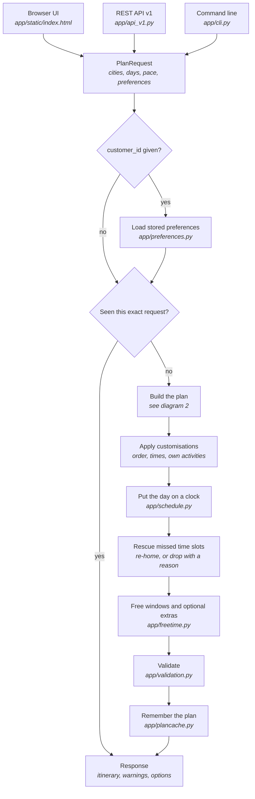
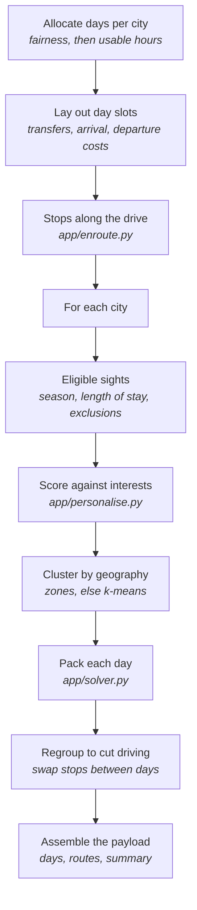
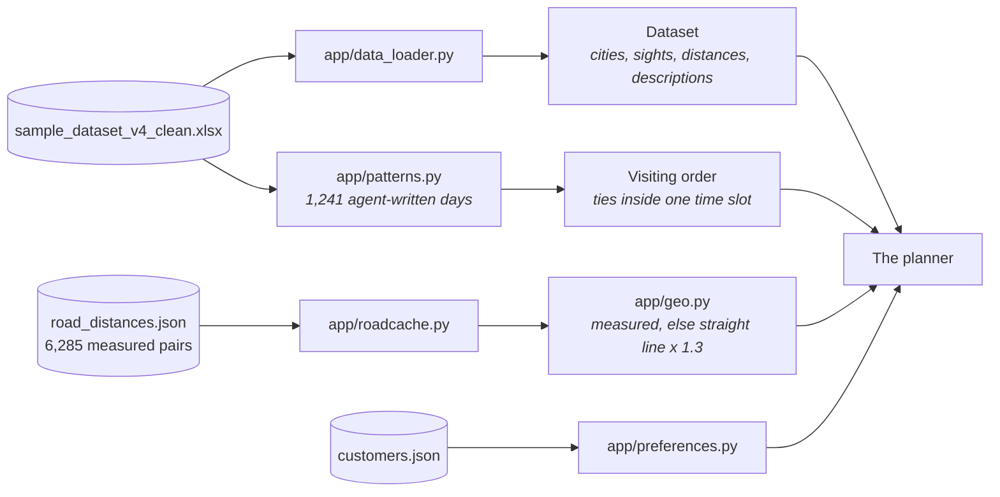
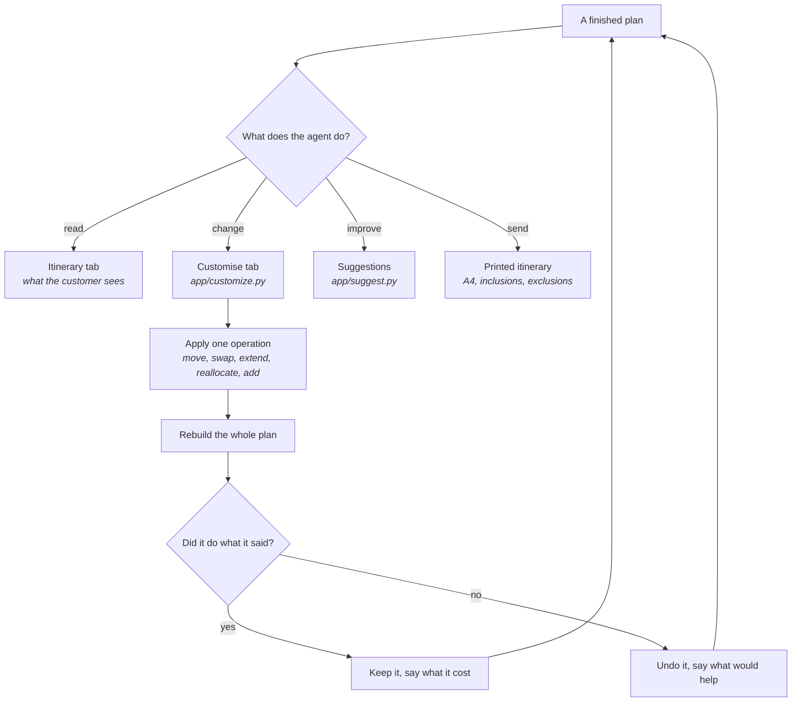

# How the engine works

Four views of the same system: where a request goes, how a plan is built, what the data
layer feeds it, and what happens after a plan exists. The diagrams are Mermaid, so they
render on GitHub and in most editors, and they can be edited as text.

Module names are given as `app/<file>.py` so each box can be found in the code.

## 1. A request, end to end

The cache is what makes editing usable: every customisation rebuilds the plan, and the UI
replays the whole list of changes each time, so the repeated prefixes are answered from
memory rather than planned again.

## 2. Building a plan

Every rule a day must obey — the hour budget, the stop cap, leg and route distances, the
evening window, the arrival-day distance limit — is checked by one function,
`evaluate_day()`. The packer, the regrouper and the edit API all call it, so none of them
can invent a day the others would reject.

## 3. Where the facts come from

Nothing is invented. A missing journey time is reported as a data gap rather than guessed,
a distance the router could not measure falls back to the estimate and is counted as one,
and an unknown sight in a pin is refused rather than dropped.

## 4. After the plan exists

Changes are applied to the *request* and the plan rebuilt, never patched into the finished
payload — that is the only way the route, the clock, the day budgets and the validator stay
in agreement. The check afterwards is what stops a stop quietly disappearing: a sight the
customer asked for either lands where they asked, or the change is undone and the response
says what would make room.

## The validation gate

A plan is returned either way, but `passed` is true only when **no critical check fails**.

| Severity | Meaning | Examples |
| --- | --- | --- |
| critical | the plan is wrong | hours that disagree with the clock, an evening sight before 16:30 that nobody asked for, a sight scheduled twice, a journey with no time in the dataset |
| warning | worth knowing | a morning sight seen in the afternoon, a slot clash the customer chose, a day that runs late because of something they added |
| note | context | what was learned from past itineraries, which legs are estimated rather than measured |

The distinction that matters: the engine holds *itself* to the hard rules, and treats the
customer's own choices as choices. Pinning three evening sights to one day is a warning
with the better times offered; the engine producing that plan on its own is a failure.
